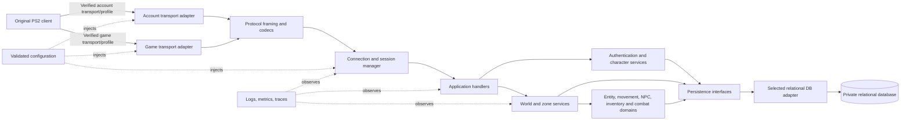
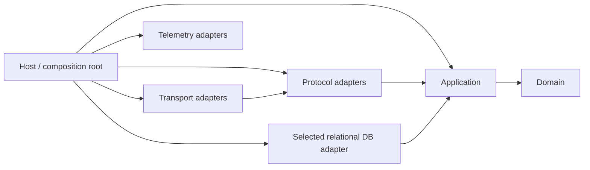

# EQOA Nighthaven Architecture Specification

**Status:** proposed architecture for the analysis phase. No server functionality is implemented or specified here as already working. This specification uses the read-only reference archaeology as evidence, not as an authoritative protocol or schema. The independent server should be built only after the relevant wire behavior is confirmed.

## 1. Evidence and decision vocabulary

Use these labels throughout the architecture and protocol work:

- **CONFIRMED — reference:** directly demonstrated by the surveyed source, configuration, schema, or repository documentation. This proves what that reference implementation contains; it does not by itself prove an EQOA requirement.
- **CONFIRMED — client/protocol:** demonstrated by a repeatable original-client capture or controlled client experiment, with client version and capture provenance recorded. No complete set of such evidence is available yet.
- **INFERRED:** a plausible interpretation that needs validation.
- **UNKNOWN:** available evidence does not settle the behavior.
- **HISTORICAL CHOICE:** a reference implementation or deployment decision that is not known to be wire-required.
- **NIGHTHAVEN DECISION:** an explicit proposed design choice for the independent server.
- **REJECTED LEGACY BEHAVIOR:** a reference behavior Nighthaven should not carry forward without compelling client evidence.

### Evidence baseline

**CONFIRMED — reference:** the archived server has a TCP account process and a UDP game process; its game code implements custom segment/message parsing, CRC handling, reliable/unreliable paths, sequence/ack handling, and opcode dispatch. It uses MySQL/MariaDB, static managers, app.config, and a large Lua/content tree. The repository README calls it deprecated. See [reference-implementation-analysis.md](reference-implementation-analysis.md), [protocol.md](protocol.md), and [protocol-message-catalog.md](protocol-message-catalog.md).

**UNKNOWN — client/protocol:** whether the original PS2 client requires those exact transports, ports, framing choices, crypto behavior, message fields, retry semantics, or service topology. These remain hypotheses until captures or controlled experiments demonstrate them. A code path in the reference is not sufficient evidence of a client requirement.

**HISTORICAL CHOICES:** .NET 6, MariaDB, stored procedures, static global managers, mixed protocol/game/persistence logic, development IPs and credentials, broad Docker Compose exposure, and a forced bind-any fallback. Nighthaven will not inherit those decisions by default.

## 2. System architecture

### Deployment and runtime shape

**NIGHTHAVEN DECISION:** begin with one modular server process. It hosts any client-required account and game endpoints in separate transport adapters while sharing application/domain services. This preserves one deployable unit without coupling their wire protocols. Split processes only if measured operational, security, or scaling needs justify it.

The server requires a relational persistence service; the initial backend is provisional and will be selected before persistence implementation. Development may use a reproducible local container for the selected backend. Client DNS redirection or patch/MOTD hosting is outside the server core and is included only if original-client testing proves it necessary. Emulators are test clients and never server dependencies.

### Dependency direction

The diagram shows runtime message flow. Compile-time dependencies point toward stable abstractions: the domain depends on no transport, protocol, database driver, host, or logging implementation. Application services depend on domain models and declared ports. Infrastructure implements those ports. The host/composition root alone selects adapters and wires concrete dependencies.

Arrows here mean “has a compile-time dependency on.” The host wires the selected concrete implementation. The relational database adapter depends on application-owned persistence ports; application code calls those ports at runtime without knowing the database vendor.

Protocol codecs may depend on protocol profile definitions and bounded parsing utilities. They must not call domain persistence directly. Domain services receive typed commands and return typed outcomes/events; application handlers decide which protocol response to encode.

## 3. Boundaries and responsibilities

Use clear modules/namespaces within the modular monolith. Keep experiments in separate projects or folders with an explicit promotion path into the stable core.

| Boundary | Owns | Must not own |
|---|---|---|
| Host / composition | Process lifecycle, dependency wiring, startup checks, shutdown coordination | Gameplay decisions or wire-field interpretation |
| Transport | Socket bind, receive/send, endpoint metadata, datagram limits, network connection lifecycle | Opcode parsing, character rules, SQL |
| Protocol framing | Datagram/stream frame boundaries, integrity checks, segment parsing, serialization | Account policy or game rules |
| Message codecs | Versioned message types, opcode mapping, field encoding/decoding, protocol profile | Database queries, sockets, broad gameplay state |
| Session/application | Associate verified messages with sessions, sequence app operations, map messages to commands and outcomes | Raw SQL and domain-specific serialization |
| Authentication | Account lookup, credential verification, auth/session policy | Wire framing and connection ownership |
| Character services | Character listing, creation, selection and lifecycle policies | Network buffer manipulation |
| World/zone | Zone instances, entity presence, visibility, transfer coordination | Client packet formats or concrete SQL driver |
| Domain | Account identity, character state, entities, movement intent, item/quest/combat rules as they are researched | Socket, protocol package, database schema details |
| Persistence ports | Repository/transaction contracts expressed in domain/application terms | Driver-specific types |
| Infrastructure | Selected relational database mapping, migrations, secret/config providers, telemetry exporter | Protocol-specific gameplay policy |
| Admin/operations | Local diagnostics, readiness, controlled and audited administrative actions | Publicly exposed unauthenticated mutation APIs |

The first slice need not implement every listed domain. Unimplemented capabilities remain absent rather than represented by copied reference code or misleading no-op services.

## 4. Core domain model

These are Nighthaven concepts, not claims that the reference schema or protocol uses the same entities or identifiers.

| Concept | Identity and responsibility |
|---|---|
| `Account` | Stable internal account ID, credential verifier, account status and policy. A client username is an external identifier, not a session key. |
| `PlayerSession` | Server-side authenticated player context. Has a stable opaque `SessionId`, account association, optional selected character, state, and reconnect deadline. It outlives a `NetworkConnection` during the allowed grace period. |
| `NetworkConnection` | One current transport attachment, identified by an ephemeral `ConnectionId`, remote endpoint, protocol negotiation/profile state, and transport liveness. It can be replaced without reusing the connection identity. |
| `Character` | Durable playable identity and progression. Selected into a session; never represented by a raw wire packet or a DB row type. |
| `ZoneInstance` | Runtime owner of a bounded zone/world simulation and its active entities. Initial topology may have one instance; boundaries remain explicit. |
| `Entity` | Runtime object with an internal `EntityId`, kind, state and zone membership. Client-visible entity handles are mapped by the protocol adapter and may have different constraints. |
| `PlayerEntity` | Runtime projection of a selected character while present in a zone. It is not the durable character record. |
| `NpcEntity` | Runtime instance based on independently authored spawn/behavior definitions. No historical NPC/content dataset is imported. |
| `ItemDefinition` / `ItemInstance` | Definition and owned instance are distinct. Definition data is independently authored or derived from permissible technical evidence; an instance has owner/location/quantity/durability as validated by protocol research. |
| `AdmissionTicket` | FIFO queue entry for a client awaiting active capacity. It is operational state, not a playable session or durable account record. |

Groups, quests, combat, abilities, merchants, loot, guilds, and chat can become explicit domain modules when their first supported behavior has adequate evidence. Do not force every reference concept into the initial model.

## 5. Runtime, persistent, and derived state

| State class | Examples | Lifetime / recovery policy |
|---|---|---|
| Persistent | Account and credential verifier; character identity, progression and approved durable inventory/quest/ability state | The selected relational database is authoritative after each committed transaction. Exact fields and save points are feature-specific and require protocol/gameplay evidence. |
| Runtime session | `SessionId`, auth state, selected-character reference, connection binding, reconnect deadline, in-flight requests | In memory in the first deployment. A transport drop preserves eligible session context for up to the configured grace period while the process remains alive. Process-restart restoration is a separate future decision. |
| Runtime world | Zone/entity presence, current movement, transient combat effects, nearby visibility, NPC behavior state | In memory and reconstructed from durable definitions/state at startup or zone entry. Persist only after deciding which values are durable. |
| Derived/cache | Client entity handle maps, visible-entity set, decoded protocol state, inventory summaries, spatial index | Rebuildable from authoritative runtime/domain data; never sole source of truth. |
| Operational ephemeral | Admission queue, live connection counters, rate-limit buckets, telemetry buffers | In-memory and observable. Queue persistence across process restart is not required initially unless operations later require it. |

**NIGHTHAVEN DECISION:** do not persist every movement update by default. Define explicit save points and atomic transactions for durable changes. On graceful shutdown, stop admission, drain/close sessions, and persist dirty durable state within a deadline. On process crash, recover from the last committed state and report any possible loss window; do not claim restoration of volatile sessions.

## 6. Connection, session, capacity and reconnect

The client brief sets operational policy; it does not establish protocol support for reconnect.

1. A network connection is created when the transport sees a client datagram/stream. It is not yet an authenticated player session.
2. Protocol handshake and authentication proceed only as the verified client exchange allows.
3. Before allocating active world capacity, apply global capacity and per-IP connection limits. If capacity is full, queue eligible clients FIFO only if protocol/client behavior allows them to wait. Otherwise return a capture-verified retry/overload response or close safely; do not invent a wire response.
4. Enforce one active session per account by default, while allowing multiple accounts behind one NAT subject to configurable per-IP technical limits. Multiboxing is not architecturally prohibited.
5. On transient network loss, detach the `ConnectionId`, preserve the eligible `PlayerSession`, and start `reconnect_grace_seconds = 600` by default. Re-authenticate/rebind using protocol evidence; never accept a new connection based only on IP address.
6. On successful rebind, assign a new `ConnectionId` to the existing `SessionId`. If the protocol cannot restore state, preserve the domain separation but fall back to a clean session transition.
7. When grace expires, persist/release the session, free capacity, and admit the first eligible FIFO waiter. Queue cancellation, duplicate-account behavior, and timeout are explicit config/policy with metrics.

**UNKNOWN:** whether the original client supports rebinding and which identity/token proves a reconnect. Until confirmed, implement session/connection separation as an internal model and defer wire-level reconnect behavior.

## 7. Protocol abstraction

Protocol compatibility is a replaceable edge. Create an `IProtocolProfile` (or equivalent immutable profile registry) that selects the target client version and binds:

- transport expectations and initial handshake stages;
- bounded frame decoders/encoders;
- integrity/checksum rules and field-specific byte-order helpers;
- message/opcode codecs and response builders;
- reliable/unreliable delivery metadata and state-channel codecs;
- endpoint/client-visible entity ID mappings;
- compatibility diagnostics and capture fixture references.

Do not use one global “endianness” assumption. Do not infer encryption, compression, sequence rules, field sizes, or session flow from class names. Profile data must link each supported field to a capture or source with confidence. Unknown messages should be counted and recorded in a bounded, redacted diagnostic form; malformed input should be rejected before application dispatch. Avoid dynamic protocol guessing in production.

**Stable core:** application commands, domain models, session lifecycle policy, persistence interfaces. **Disposable experiments:** capture parsers, replay/diff tools, emulator-specific behavior, unvalidated opcode codecs. Promote an experiment only when fixtures and evidence support it.

## 8. Configuration and operational policy

Use typed configuration loaded in a deterministic order: checked-in non-secret defaults, deployment config, environment overrides, and a dedicated secret provider. Validate all values before opening listeners. Log the effective non-secret configuration/profile at startup.

Proposed settings (names are illustrative and should be standardized before implementation):

| Setting | Initial policy |
|---|---|
| `protocol.profile` | Explicit target client profile; no guessed auto-detection |
| `transport.game.bind_address` / `port` | Required deployment values, finalized from packet/client research; do not assume legacy `10070` is mandatory |
| `transport.account.enabled` / `bind_address` / `port` | Enabled only if target client flow requires it; endpoint and port remain evidence-driven |
| `capacity.global_active_clients` | Required configurable positive limit; deployment-selected, not hard-coded gameplay cap |
| `capacity.per_ip_connections` | Required configurable limit sized for shared NAT; emit rejection metrics |
| `capacity.one_active_client_per_account` | `true` initial default |
| `capacity.admission_queue_enabled` | Configurable; enable only where client flow supports waiting |
| `capacity.admission_queue_limit` / `wait_timeout_seconds` | Explicit bounded policy; no unbounded queue |
| `session.reconnect_grace_seconds` | `600` initial target; observable and configurable |
| `session.idle_timeout_seconds` | Evidence-driven and configurable; no copied reference timeout |
| `database.connection_string` | Secret provider only; private network endpoint |
| `logging.level` / `packet_diagnostics` | Safe defaults, credentials/secret redaction mandatory |
| `admin.enabled` | Off by default; local-only controlled access if enabled |

Avoid checked-in LAN addresses, placeholder credentials, silent bind-any fallbacks, and magic behavior switches. Invalid config should fail startup with a specific actionable error.

## 9. Observability

Emit structured logs with correlation IDs for connection, session, account-safe pseudonym, request/message, and zone. Never log passwords, credential bytes, session secrets, or full raw packets by default. Capture diagnostics should use explicit opt-in, bounded sampling, redaction, and retention limits.

Minimum metrics: current connections, authenticated sessions, active players, per-IP connection count distribution, queue length/oldest wait, capacity rejections, auth outcomes by reason (not username), reconnect attempts/success/expiry, malformed/unknown packet counts by profile/opcode, CRC/integrity failures, reliable retransmits/ack delay where defined, zone entity counts, DB latency/errors, persistence failures, and graceful-shutdown drain results.

Provide liveness/readiness status without opening an unnecessary public management port. Readiness requires validated config and persistence availability; liveness should avoid making a transient database outage restart-loop the process. Administrative mutations must be authenticated, permissioned, and audited.

## 10. Persistence boundary and database evaluation

### Boundary

Application/domain code uses narrowly scoped interfaces such as `IAccountRepository`, `ICharacterRepository`, and transaction-capable inventory/character operations. Infrastructure owns SQL, driver types, migrations, connection management, and row mapping. Protocol models never become DB entities. Use explicit transactions for coupled durable changes (for example, character creation plus defaults or an inventory/economy mutation) and define idempotency/concurrency behavior before exposing them through messages.

The first schema should be designed from Nighthaven domain and verified needs, not copied from `eqoabase_schema.sql`. Store independently authored compatible definitions with provenance. Exclude historical seed data, client assets, dialogue, maps and bulk copyrighted content.

### MySQL/MariaDB vs PostgreSQL — backend selection is provisional

| Criterion | MySQL/MariaDB | PostgreSQL |
|---|---|---|
| Evidence | **CONFIRMED — reference:** the public reference provides MySQL/MariaDB schema, stored-procedure, and data-access evidence. The project/operator also has greater familiarity with this backend. | No demonstrated Nighthaven requirement currently depends on PostgreSQL-specific capabilities. |
| Schema coupling | Reference persistence is MySQL-specific, but Nighthaven will design its own schema rather than copy it. Familiarity and migration knowledge are concrete benefits. | PostgreSQL remains a candidate; no unique engineering benefit has yet been demonstrated for this project. |
| Modernization rationale | Modernization is not a goal by itself; use MariaDB if it is the best fit after the backend review. | Select only if a concrete, documented engineering benefit outweighs the operator's MySQL/MariaDB familiarity and migration cost. |
| Protocol compatibility | No direct client wire dependency demonstrated. | No direct client wire dependency demonstrated. |

**Provisional decision:** Nighthaven requires a relational persistence boundary; the initial database backend is not finalized. MySQL/MariaDB and PostgreSQL remain candidates, with MySQL/MariaDB a serious candidate given the reference evidence and operator familiarity. There is currently no demonstrated requirement that PostgreSQL uniquely satisfies. Select one backend before persistence implementation begins. Do not build multiple adapters for theoretical portability. Keep database-vendor types and SQL behind the selected adapter so domain and application code remain vendor-independent.

## 11. Security boundaries

- Treat every client message as untrusted. Bound datagram/frame size, validate lengths before allocation, reject malformed input before dispatch, and isolate parse errors per connection.
- Authentication must verify credentials according to the client-compatible exchange. The reference's disabled-decryption/account-existence path is **REJECTED LEGACY BEHAVIOR**. Do not accept a login solely because an account exists.
- Keep password verification and any required legacy-compatible client crypto in a narrow authentication adapter. Store modern salted password verifiers for Nighthaven accounts where the client flow permits; do not log or persist captured plaintext/credential material.
- Do not assume the old game protocol provides modern transport confidentiality, authenticity, or replay protection. This remains **UNKNOWN**; compensate with rate limits, strict session binding, replay/sequence checks only where confirmed, least privilege, and private service networks.
- Enforce account ownership on every character action and server-authoritative validation for movement/economy/state changes. Avoid trusting client position, damage, item prices, or IDs without validation.
- Limit per-IP resource use while supporting NAT households. Distinguish network-level rate limits from account/session limits; make limits configurable and observable.
- Bind database to a private interface, use a dedicated least-privilege DB role, protect credentials in a secret provider, and encrypt backups. Do not expose database/admin ports publicly.
- Keep admin tooling disabled or local/private by default. Audit changes and avoid unauthenticated chat-based admin commands from the historical code.

## 12. Deployment topology

Initial topology: one Nighthaven server process with client-required account/game listeners, one private relational database service using the backend selected before persistence implementation, and optional external DNS/HTTP bootstrap components only when demonstrated necessary by the target client. DNAS behavior is an open client interoperability question; this specification does not assume it requires a Nighthaven-side service or choose a bypass. If research establishes a replacement/bypass requirement, it must use Nighthaven-owned endpoints and explicit configuration, never another revival project's infrastructure. Use one host or a simple compose/system service for reproducible deployment; Kubernetes and distributed services are out of scope absent measured need.

Expose only verified client endpoints. The historical reference used 9735/TCP, 10070/UDP, DNS, HTTP, and public MariaDB in its compose sample; those values are **HISTORICAL**, not target ports. Keep the selected database and admin interfaces private. Configure explicit bind addresses and firewall rules. Document install, migration, backup, restore, upgrade, health checks, and rollback. Emulator and client experiments run outside the production server dependency graph.

## 13. Testing strategy

Testing is part of the proposed design; no tests are being implemented or run as part of this specification task.

1. **Codec unit tests:** verified byte fixtures for each supported frame/message, field boundaries, byte order, checksum, truncation, unknown flags/opcodes, max lengths and sequence wrap where captures establish expected behavior.
2. **Property/fuzz tests:** parsers never read out of bounds, allocate from unchecked lengths, hang, or crash the host; malformed packets produce bounded diagnostics.
3. **Application/domain tests:** session state transitions, ownership checks, admission FIFO, limits, one-account policy, queue cancellation, 600-second reconnect expiry, and slot release/admit-next behavior using a controllable clock.
4. **Persistence integration tests:** selected-backend migrations from an empty DB, transaction rollback, account/character uniqueness, inventory atomicity when implemented, backup/restore smoke test, and DB outage behavior.
5. **Protocol replay tests:** deterministic replay of capture fixtures and byte-for-byte encoder comparisons. Fixtures must document client revision, direction, context and provenance, with secrets removed.
6. **Client interoperability:** original PS2 client is the compatibility target. PCSX2 and later client-side PS2 Classic/RPCS3 experiments may be used to isolate issues but cannot become required server dependencies.
7. **Operational recovery:** packet loss/reorder simulation where relevant, transient disconnect/reconnect, grace expiry, FIFO admission, DB outage/recovery, graceful shutdown, process crash/restart, and load at configured capacity.

Do not claim protocol support from passing unit tests alone. Keep each feature tied to at least one evidence-backed client exchange.

## 14. First implementable vertical slice

The first slice should prove process, protocol, session, persistence, and recovery boundaries with the smallest useful original-client flow. It is not a request to implement broad gameplay.

**Scope, after the necessary capture/client experiment:**

1. After selecting a relational backend, start the host with validated config and a private database; expose only the endpoints proven necessary.
2. Parse the verified initial client handshake and authentication exchange for one explicit client profile; reject invalid credentials.
3. Create a `NetworkConnection`, authenticate, apply configurable capacity/account policy, and create a distinct `PlayerSession`.
4. Begin with an account that has no characters. Implement the capture-backed, complete client-driven creation path for one standard in-scope character, covering the client-visible choices, validation steps and response observed for the selected profile; refresh the list, verify the new character appears, and select it. A pre-provisioned character does not satisfy this first-slice acceptance.
5. Enter one test zone with a player entity and support only the minimum movement/state messages needed to demonstrate client-visible presence, if confirmed.
6. Persist only a demonstrated durable character change or a cleanly selected character state; close/disconnect and verify reload.
7. Exercise transient connection loss and reconnect within the grace period only if the client protocol supports it; otherwise test internal expiry, persistence, slot release and FIFO admission without claiming client rebind support.

**Explicitly out of scope:** broad NPC content, combat, abilities, quests, merchants, loot, groups, guilds, scripting, map ingestion, nonstandard race/class combinations, ruleset-specific behavior, and proprietary assets. These are later milestones. A future, separately scoped compatibility experiment may use a pre-provisioned character to test loading/display/selection of a candidate nonstandard race/class combination; that does not establish that the client creation flow permits the combination and cannot replace the standard client-driven creation path above.

## 15. Unresolved questions and evidence gates

The following are blocking protocol questions for wire implementation, not for this architecture:

- Which original PS2 client/disc revisions and bootstrap path are in scope? Does the client require both account TCP and game UDP services, and what endpoints/ports does it discover?
- What DNAS check/service interaction occurs for each target client revision, and what compatibility behavior (if any) is needed to operate independently of the historical SOE service?
- What are exact frame boundaries, field-specific byte order, CRC/integrity rules, message lengths and maximum sizes?
- What are session creation, handshake, acknowledgement, retransmission, duplicate/reorder, segmentation, timeout, reset and reconnect semantics?
- What authentication bytes, crypto, key/padding behavior and account service messages does the target client require?
- For the selected client profile, what is the observed sequence for server selection, an empty character list, client-driven creation, refreshed list, character selection, world entry and zone transfer?
- What movement and entity replication formats are required for a first visible avatar? How do client-visible entity IDs map to server identities?
- What behavior does the client expect for unknown opcodes, invalid packets, overload, disconnect and server shutdown?
- Which state is durably saved by the original service, and what save/recovery boundaries are needed for the initial slice?

### DNAS and bootstrap compatibility evidence gate

**Project premise, pending Nighthaven verification:** the original client includes a DNAS-related check/service dependency associated with historical SOE infrastructure. Treat this as a client interoperability/bootstrap issue, not an assumed Nighthaven server component.

**Research/reference evidence:** Sandstorm's public install page says its game patch replaces the DNAS check and that its current patch no longer relies on DNS to find its server. It offers a patched-ISO path and a runtime PCSX2 `.pnach` alternative. Its project history reports that after its DNAS bypass the client proceeded to contact a patch server, after which patch/login services were involved before the client sent UDP game-server traffic. This supports an initial interpretation that Sandstorm's documented bypass changes client-side executable behavior to get past the unavailable DNAS gate; it does not establish that Nighthaven needs the same modifications, that a server-side DNAS replacement is required, or which exact bytes/endpoints are changed. See [Sandstorm Install & Connect](https://eqoa.live/install.html) and [Sandstorm project history](https://eqoa.live/story.html). These are research references only. Nighthaven must not depend on Sandstorm endpoints or copy its patch/code.

Before implementation, collect evidence for each intended client revision:

1. Record the exact disc/client revision and clean-client startup sequence, including DNAS, DNS, patch/update, account, and game-server stages.
2. Capture and identify DNAS-related network requests/responses, destinations, transport, timing, and the exact condition that blocks progression when historical services are unavailable.
3. Compare clean-client behavior with the documented revival compatibility method in a lawful, controlled setup. Identify whether changes are limited to bypassing the DNAS result gate or also redirect endpoints, skip/update patch logic, or alter later login/game behavior. Keep patch/version/hash and observations in the research record; do not import the patch.
4. Test whether Nighthaven can operate with no DNAS-specific server, needs a client-side compatibility change, or needs an independently operated replacement behavior. Confirm which portions are necessary on original PS2 hardware; treat PCSX2-only behavior as separate evidence.
5. Only then choose a version-specific, Nighthaven-owned compatibility design and configure its own endpoints. Do not assume a bypass mechanism in advance.

Use [open-questions.md](open-questions.md) for the broader evidence plan and [protocol-message-catalog.md](protocol-message-catalog.md) for source-derived message observations. Promote an unknown to **CONFIRMED — client/protocol** only after repeatable, provenance-documented captures or controlled experiments. Preserve contradictory findings instead of silently selecting the reference behavior.

## Rejected historical behavior summary

Nighthaven should not inherit the reference's permissive account-existence login path, unverified password-change success, generic catch-all exception-to-unknown-opcode handling, silent CRC-failure continuation, fixed small packet assumptions, forced bind-any fallback, static global session/game state, unchecked hard-coded topology, exposed development DB credentials/port, or reliance on README feature claims as completeness evidence. If original-client interoperability demands any historically compatible wire behavior, implement that behavior in a narrow, tested protocol adapter with a security/operational rationale; do not spread the legacy architecture with it.

