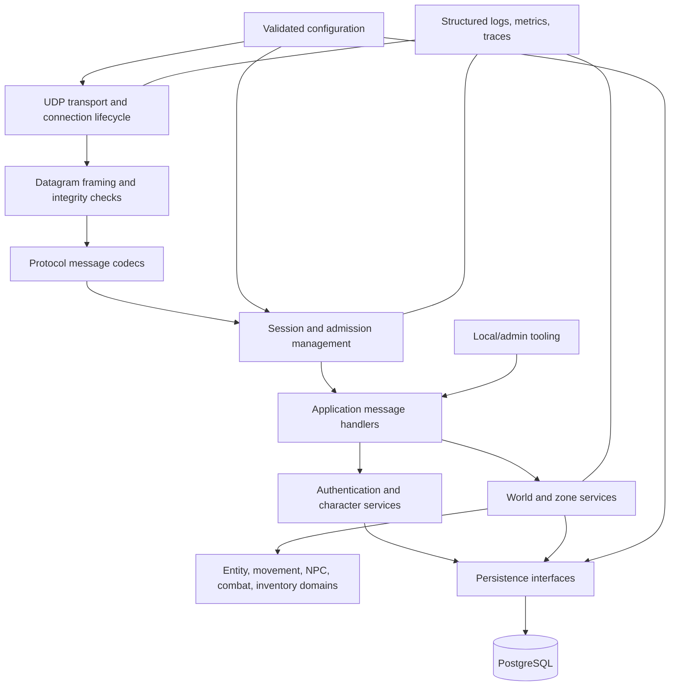

# Nighthaven architecture

## Status and evidence rules

This is an independent architecture proposal grounded in the read-only `EQOAGameServer` reference survey. It does not assert that a reference implementation choice is an EQOA requirement. See [reference-implementation-analysis.md](reference-implementation-analysis.md), [protocol-message-catalog.md](protocol-message-catalog.md), and [open-questions.md](open-questions.md).

Evidence labels: **CONFIRMED** means directly present in inspected source/config/schema; **INFERRED** means a plausible interpretation rather than a protocol guarantee; **UNKNOWN** means the repository does not establish it; **OBSOLETE / HISTORICAL** describes an implementation constraint, not protocol behavior.

## Design constraints

- Stable core, disposable experiments, explicit dependencies, predictable names, minimal exposed ports, reproducible configuration, observable operation, tested recovery.
- Prefer one well-structured, modern supported .NET server process and PostgreSQL. Keep deployment simple; no microservices or Kubernetes without a demonstrated requirement.
- Keep original PS2 interoperability independent of emulator-specific behavior. Do not package proprietary game assets.
- The reference uses distinct TCP account and UDP world services (**CONFIRMED**); whether this split or its exact endpoints are required for compatibility is **UNKNOWN** until client/capture testing confirms it.

## Logical boundaries and dependency direction

Raw sockets belong in Transport. Wire bytes and framing belong in Protocol. Application handlers translate validated messages to domain commands. Domain code must not depend on sockets, packet buffers, SQL, or a concrete PostgreSQL driver. Persistence adapters map domain data to storage. Protocol codecs must not query the database.

| Boundary | Responsibility | Key contract |
|---|---|---|
| Transport | Bind minimal configured endpoint(s); receive/send datagrams; rate and size limits | Connection identity is ephemeral and separate from player session identity |
| Protocol framing | Parse/emit verified datagram, segment, CRC and channel framing | Bounded, deterministic, independently testable codecs |
| Message codec | Typed message models, opcode registry, version/profile selection | Unknown or malformed messages are observable and safely rejected |
| Session management | Session lifecycle, account exclusivity, reconnect, admission queue | Session identity survives transient connection replacement where protocol allows |
| Authentication | Client-facing authentication exchange and account verification | Password verification policy is isolated from game session lifecycle |
| Character services | Create/list/select/delete and character persistence | Domain validation independent of wire representation |
| World / zone | Zone state, visibility, entity lifecycle and zone transfer | Zone state has explicit ownership; start as in-process modules |
| Entity / movement | Entity identity, movement validation and replication intent | Protocol-specific movement serialization sits outside domain model |
| NPCs | Spawn templates, behavior hooks, interactions | Experiment/script runtime is replaceable and sandboxable |
| Combat / abilities | Targeting, damage, effects, death and recovery | Deterministic domain rules with explicit persistence events |
| Inventory / items | Item definitions, stacks, equipment, merchant/loot transactions | Atomic domain operations; immutable protocol-independent item IDs |
| Persistence | Repository interfaces and transaction boundaries | PostgreSQL adapter only at infrastructure edge |
| Configuration | Typed, validated environment/file configuration | No secrets in source; startup fails clearly on invalid required settings |
| Observability | Structured logs, metrics, health/readiness, bounded packet diagnostics | Never log credentials or unrestricted packet contents by default |
| Admin tooling | Local authenticated diagnostics and controlled admin commands | No public management port by default; audit all mutations |

## Runtime and lifecycle

**Reference facts:** `GameServer.Main` reads server-list configuration, initializes client crypto settings, starts a periodic server-list distribution timer, initializes world state, then starts UDP listeners. `WorldServer.Initialize` and `SocketManager.Initialize` are the central startup seams. Auth has a separate `Main`, account initialization, then TCP listener. UDP session creation and deletion are managed by static `SessionManager`; session/player/world managers and static collections share process state. The README describes DNS, HTTP patch content, auth, game, and MariaDB as deployment services.

**Nighthaven proposal:** startup should validate configuration, initialize logging and persistence, load protocol profile and static definitions, construct domain/application services, start transport last, then report readiness. Shutdown should stop admissions, notify/close sessions within a bounded deadline, persist dirty character state, stop transport, flush logs, and dispose persistence. This is a proposal; graceful reference shutdown is **UNKNOWN** and the inspected listener loops are unbounded.

Concurrency should begin with a bounded async receive loop and explicit per-session serialization (actor/mailbox or lock discipline); zone simulation can use a predictable tick only where gameplay timing requires it. Avoid unbounded `Task.Run` per accepted connection and shared mutable global collections. Use cancellation tokens, backpressure, bounded queues, and explicit ownership. This is a design recommendation, not a claim about wire requirements.

## Session capacity, queue and reconnect policy

- Configurable `global_active_client_capacity`, `per_ip_connection_capacity`, and `one_active_client_per_account` (initial default true). IP limits must tolerate shared NAT: configure high enough for household usage and observe rejections. Multiboxing is not prohibited by the architecture.
- When active capacity is full, optionally place authenticated clients in an observable FIFO queue. Define queue cancellation, timeout, duplicate-account handling, and admission fairness. Queue state should not count as active player state.
- Keep `SessionId` separate from `ConnectionId`. On transient disconnect, mark the session disconnected and start configurable `reconnect_grace_seconds` (initial target 600). A valid reconnect rebinds a new connection to that session if supported by the protocol/security model. On expiry, persist/release the session and active slot, then admit the first eligible waiter.
- These are Nighthaven operational requirements from the project brief. Compatibility support for connection rebinding and server-side state restoration is **UNKNOWN** until protocol behavior is researched.
- Emit metrics for active sessions, live connections, per-IP counts, queued clients, queue age, reconnects, grace expiry, and admission rejection reason. Do not key identity solely on IP.

## Deployment shape

Start with a single server executable plus PostgreSQL. Expose only the client-required game and account endpoints after captures establish them. DNS redirection and HTTP patch delivery may be separate deployment concerns for client setup; the legacy compose file exposes DNS 53, HTTP 7000, account TCP 9735, game UDP 10070, and MariaDB 3306, but that exposure set is not Nighthaven's target. Bind database/admin interfaces privately. Externalize addresses, ports, limits, protocol profile, and secrets.

## Compatibility versus implementation choices

**Potential compatibility-sensitive behavior (requires validation):** datagram transport; byte-level framing and integrity; session establishment/teardown; message IDs and field encodings; reliable/unreliable channels and acknowledgements; client build/version behavior; authentication exchange; world/character-entry state sequence; movement/entity replication. The reference is evidence for its own implementation only.

**Choices Nighthaven should not inherit automatically:** .NET 6 target, MariaDB and stored procedures, statically global managers, hard-coded topology/fallbacks, script and game logic coupled to raw message handlers, reference timer/task behavior, Docker Compose service layout, public database port, and reference schema. These are historical engineering choices unless independent compatibility evidence proves otherwise.

