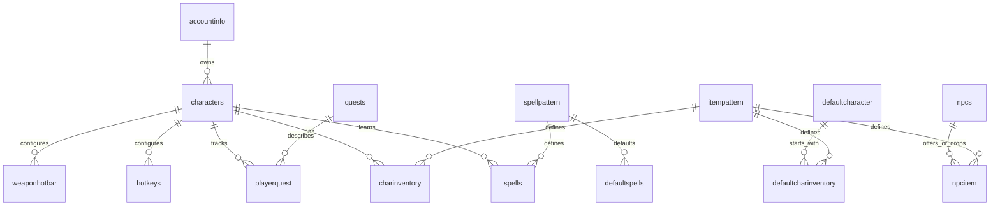

# Database and persistence analysis

## Reference technology

**CONFIRMED:** The reference uses `MySqlConnector` (0.69.4) and MariaDB/MySQL SQL. Compose specifies MariaDB 10.2; the schema dump header identifies MariaDB 10.3.37. SQL setup and game code use stored procedures. The checked-in schema uses InnoDB, with mixed `utf8mb4` and `latin1` tables. No ORM is used for ordinary persistence; references include `Z.EntityFramework.Extensions.EFCore`, but the inspected data access shown uses direct `MySqlCommand`/reader calls.

`docker-sql/eqoabase_schema.sql` defines `accountinfo`, `characters`, `charinventory`, `itempattern`, `npcs`, `npcitem`, `quests`, `playerquest`, `spells`, `spellpattern`, `defaultcharacter`, `defaultcharinventory`, `defaultspells`, `hotkeys`, and `weaponhotbar`. `EQOA_Master.sql` overlaps schema/bootstrap content. Stored procedures include account and character CRUD/list/load/save operations, inventory operations, and hotbar/spell/quest access.

## Observed data model

This reflects declared schema constraints where present; the account-to-character relation is a logical/schema column association and not every relationship is enforced with an FK. Inspect the schema before relying on referential guarantees.

| Area | Evidence-based shape | Runtime/persistence note |
|---|---|---|
| Accounts | `accountinfo` has account ID, unique username, password hash field, status, feature/subscription fields and profile fields | Auth server has defaults in client object; account database behavior must be distinguished from returned defaults |
| Characters | `characters` stores account association, name, race/class/model, level/XP, appearance, tunar, stats, world and coordinates, flags and quest JSON/text fields | Character entity is loaded into session; some changes save immediately, but source comments also flag unsaved character changes |
| Inventory | `charinventory` links character/server ID and item pattern, with item ID, quantity, location/slot and durability-like data | Game code has item ID allocation and inventory transaction logic; stacking/rearrangement TODOs exist |
| Item definitions | `itempattern` stores item definitions | Avoid copying copyrighted content; Nighthaven should use clean-room independently authored or technically necessary compatible identifiers/data only |
| NPC/world | `npcs` stores NPC templates/spawn-like data; `npcitem` links NPCs and item patterns | Runtime world managers, map/quad trees and scripts hold behavior/state; exact persistence of mutable NPC state is not established |
| Quests | `quests` plus `playerquest`; character rows also include active/completed quest text/JSON | Duplicated/overlapping representations possible; consistency rules are unknown |
| Abilities | `spellpattern` and per-character `spells`; default spell table | Combat spell execution completeness is partial/unclear |
| UI preferences | `hotkeys`, `weaponhotbar` | Character-owned configuration with FK cascade in schema |
| Combat state | Character HP/power and stats are persisted; no separate combat event/history model is evidenced | Combat persistence and transaction semantics unknown |
| Configuration | Endpoint/game config is in app.config, not shown as DB config | Treat operational config as externalized typed config in Nighthaven |

## Boundaries and concerns

The reference data-access layer exposes concrete MySQL connections and commands into server code. A Nighthaven design should use repository/unit-of-work interfaces behind application/domain boundaries and PostgreSQL transactions for multi-record operations (character creation plus defaults, purchase/sale, loot claim, quest update). Define ownership, uniqueness, concurrency, and recovery semantics explicitly. Store stable IDs and normalized domain state; avoid serializing arbitrary flags/quest structures as opaque blobs without a migration strategy. Keep protocol byte layouts out of schema types.

## Nighthaven proposal

Use PostgreSQL, migrations checked into Nighthaven, explicit FK/unique constraints, UTC timestamps, transactions for economy/inventory changes, optimistic concurrency where multiple handlers could update one character, and a documented backup/restore process. Separate account credentials, account policy, characters, item definitions, character item instances, quest progress, ability definitions/learned abilities, zone spawn definitions, and audit records. Static compatible data should have provenance and licensing review; do not import proprietary game assets or legacy bulk content.

Exact schema is intentionally deferred until protocol compatibility and the first supported gameplay slice are validated. The reference schema is evidence for that server only, not an authoritative EQOA schema.

