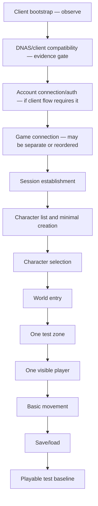

# Protocol evidence acquisition plan

This is an ordered, evidence-only plan. No network listeners, packet codecs, DNAS behavior, authentication, database, or server functionality are implemented here.

## Pass #5 checkpoint

Acquisition has begun with [hashed static client-artifact observations](pass5-status.md) and a prepared isolated E00 run card. This is supporting archaeology, not completion of E00/E01 or a change to the ordered experiments. Static manifests may use `source_kind: static_client_artifacts` with `method: S`; capture timestamp, transport, endpoints and packet boundaries must be null when no runtime capture occurred. Existing capture metadata and promotion requirements below still apply to actual runs.

## Research order and dependencies

The order below prioritizes upstream blockers. Do not reverse it merely to start coding earlier.

| Order | Research stage | Why it precedes later work | Exit evidence |
|---:|---|---|---|
| 0 | Select client profile and baseline environment | Captures are uninterpretable without exact revision/runtime/config. | Identified disc/build, own-image hash, PS2/emulator environment, network setup and experiment record. |
| 1 | Cold-start bootstrap + DNAS | Establishes if and how any client-side compatibility, DNS, HTTP or DNAS-related behavior gates the services below. | Captured stage timeline, destination metadata, independent availability experiments, client progression outcome. |
| 2 | Server discovery and endpoint selection | The first account/game capture depends on knowing where the client attempts to connect and why. | Exact observed destination(s), transport and discovery transition for the chosen profile. |
| 3 | Account service and game-service first contact | Defines which services exist and whether account and game exchanges are separate or coupled. | Valid/invalid account test exchange and first game datagram, each paired with client result. |
| 4 | Game framing and integrity | Required before interpreting session, opcode, or character messages. | Repeatable packet boundaries, field-by-field byte observations, CRC/integrity vector and rejection behavior. |
| 5 | Session/reliability subset used during login | Needed to know whether later application messages are accepted/delivered and how to correlate them. | Observed session handshake, IDs, ack/sequence progression, and controlled-loss evidence for the subset in use. |
| 6 | Character list, creation and selection | First application-level slice after session and authentication. | Captured empty/list response, one independently created character, refreshed list and selection transition with client screen/result. |
| 7 | World entry and initial entity | Depends on selection and session; prevents building world messages against guessed entry flow. | Capture from selected character to stable zone and one visible player entity. |
| 8 | Movement and minimal replication | Required for playable baseline, but unnecessary before a client-visible entity exists. | Paired controlled movement input and server/client replication with timing and field hypotheses validated. |
| 9 | Disconnect, reconnect and save/load | Important recovery behavior, downstream of a stable session and character state. | Normal logout, abrupt loss, process lifetime and reload traces; reconnect conclusion per client profile. |

Defer broad combat, spell, quest, inventory, guild, merchant, loot, NPC scripting, and full world replication research until the baseline needs them. The operator-prioritized first playable path includes character creation. Research the minimal create flow in E08 after list framing is understood, then verify the created character appears and can be selected. A provisioned character can support an intermediate list/select experiment but does not satisfy the creation requirement.

## Experiment cards

Each experiment is intentionally narrow. Perform it with a client and environment the operator is authorized to use. Use a passive capture first; do not use a Sandstorm endpoint as the Nighthaven endpoint.

### E00 — Client profile and clean baseline

- **Objective:** Make later observations attributable to one client build and runtime.
- **Prerequisite:** A legally available original client/media path and an isolated capture network.
- **Setup:** Record region/edition/build identifiers, hash the operator's own disc image, PS2 model or emulator/BIOS/network-plugin versions, network settings, DNS and clock. Do not place images/BIOS in Nighthaven.
- **Action:** Cold boot to the first stable screen before any deliberate login action; repeat at least three times without changing configuration.
- **Capture:** UTC timestamps, environment manifest, DNS and all network flows, screen/state milestones, packet capture hash.
- **Expected evidence:** Repeatability of startup stage order and destinations for one profile.
- **Interpretations:** Identical behavior supports a profile baseline; differences indicate a hidden variable or non-deterministic stage.
- **Still unknown:** Meanings of payload fields and whether another client revision behaves similarly.
- **Unlocks:** Establishes the named profile for all subsequent experiments; not enough by itself to implement a listener.

### E01 — Bootstrap and DNAS stage timeline

- **Objective:** Determine when DNAS-related activity occurs relative to DNS, patch/MOTD, account and game connections.
- **Prerequisite:** E00 baseline.
- **Setup:** Capture from cold boot on a controlled network. Start with passive traffic observation and record client-visible outcomes.
- **Action:** Repeat a clean run; in separate runs, make one observed destination unavailable at a time where safe and observable. Do not assume which destination is DNAS until correlation supports it.
- **Capture:** DNS questions/answers, TCP/UDP flow endpoints and timing, HTTP request/response metadata if present, client screen/errors/retries, exact changed condition.
- **Expected evidence:** An ordered timeline and whether a given network stage gates the next stage.
- **Interpretations:** A failure after one isolated destination is blocked suggests dependency; a client progressing without that flow suggests optionality for that profile. Neither identifies payload semantics automatically.
- **Still unknown:** DNAS request/response bytes, gate mechanism, version differences, and whether the failure was caused by the intended block.
- **Unlocks:** Bootstrap endpoint requirements and DNAS experiment target. No bypass/service decision yet.

### E02 — DNAS differential and dependency isolation

- **Objective:** Identify what DNAS compatibility behavior is actually necessary and distinguish client changes from service changes.
- **Prerequisite:** E01 identifies the DNAS-related stage and a clean baseline.
- **Setup:** Use separate, documented client runs: baseline client if the historical service can be observed safely; then a revival compatibility method only as an external reference experiment, if lawfully available. Record patch/cheat identity and hash without copying it into Nighthaven. Use a controlled lab, no reliance on revival endpoints for Nighthaven.
- **Action:** Compare client progression and traffic for baseline and the alternative method. Vary DNAS-associated reachability separately from DNS, patch, account, and game endpoints. Keep one variable changed per run.
- **Capture:** Exact client/revision/runtime, changed input, DNS and endpoint trace, packet metadata, visible client result, and whether requests proceed to patch, account or game service.
- **Expected evidence:** Whether the observed compatibility method changes client-side gating, endpoint selection, service dependence, or more than one behavior.
- **Interpretations:** If client proceeds after a client-side change with no DNAS traffic, the DNAS gate may be bypassed in that path. If a response is required, a service dependency remains. If destinations change, endpoint redirection is a separate requirement. Do not infer exact mechanism from progression alone.
- **Still unknown:** Other client revisions, all modified code regions, legal/operational requirements for any patch, and whether physical PS2 matches emulator behavior.
- **Unlocks:** A reasoned decision among no DNAS-specific Nighthaven behavior, client-side compatibility, Nighthaven-owned endpoint redirection, Nighthaven-owned response behavior, or a measured combination. Implementation remains blocked until evidence is adequate.

### E03 — Discovery and endpoint choice

- **Objective:** Find how the selected client learns the account/game service destination.
- **Prerequisite:** E01 bootstrap timeline; E02 if DNAS gates discovery.
- **Setup:** Baseline DNS/HTTP visibility and a service-free or controlled test network where requests can be observed.
- **Action:** Progress through bootstrap/server selection without making unrelated changes. If safe, change only one documented discovery input and repeat.
- **Capture:** DNS names/results, HTTP hosts/paths/status/lengths, any server-list protocol exchange, server selection action, resulting account/game endpoint tuples.
- **Expected evidence:** Observed endpoint source and whether client connects to one or several services.
- **Interpretations:** A protocol server-list response followed by UDP suggests that response controls selection; DNS/HTTP may still be bootstrap dependencies. A configured endpoint in emulator or memory card does not prove original hardware uses it.
- **Still unknown:** All alternate revisions and hidden fallback behavior.
- **Unlocks:** Which transport adapters and deployment endpoints Nighthaven must plan for.

### E04 — Account transport and authentication exchange

- **Objective:** Establish account request/response framing, valid/invalid credential behavior and connection lifecycle.
- **Prerequisite:** E03 identifies destination; isolated test credentials and controlled server endpoint available.
- **Setup:** Capture only the account exchange; use throwaway test accounts, no real password reuse. Ensure capture storage is restricted.
- **Action:** Run one valid login, one invalid password, one unknown username if safe, and one normal close. Change no other variables.
- **Capture:** TCP connect/close, raw stream bytes plus stream offsets (not assumed packet boundaries), lengths/types, timings, client outcome and redacted test identity.
- **Expected evidence:** Request/response byte sequences and observed user-visible result distinctions.
- **Interpretations:** Different responses may indicate invalid credentials, account state or protocol error; client screen alone may collapse them. Repeated TCP reads are stream chunks, not necessarily message frames.
- **Still unknown:** Password crypto fields until decoded/corroborated, account/game identity binding, untested response types, physical PS2 behavior if only emulator tested.
- **Unlocks:** Authentication transport/protocol scope. Does not settle game UDP session framing.

### E05 — First game datagram and session establishment

- **Objective:** Capture the transition from game endpoint connect/first datagram to a stable session.
- **Prerequisite:** E03 endpoint selection and whatever E04/preceding auth stage is shown to be required.
- **Setup:** Start fresh client session; capture full bidirectional UDP and annotate client screen state.
- **Action:** Repeat clean connection; separately stop the server response after one observed datagram to observe client retry/timeout behavior.
- **Capture:** Raw datagrams, endpoint tuples, inter-arrival timing, repeated bytes, client state, socket open/close and experiment condition.
- **Expected evidence:** Initial client/server packet ordering, stable identifiers and observed retry behavior for this handshake.
- **Interpretations:** Repeated datagram may be retry or periodic message; only response/action correlation distinguishes these. A server packet from reference is not proof it is required.
- **Still unknown:** Full session semantics, behavior after packet loss in other states, endpoint variations, reconnect.
- **Unlocks:** Minimum session-handshake wire model for this client profile.

### E06 — Framing, byte order, lengths and CRC

- **Objective:** Derive the outer framing and integrity behavior from repeated packets before coding a codec.
- **Prerequisite:** E05 raw captures; static review of reference frame parser and CRC code.
- **Setup:** Select packets with repeated structure and packets containing a controlled client action likely to vary one known value. Use no guessed field offsets as facts.
- **Action:** Compare several same-stage packets and candidate decoded fields; independently derive reference CRC vectors from static code. If testing bit flips, do so against a disposable local endpoint and never production/historical service.
- **Capture:** Original bytes and hashes, candidate offsets/values, decoder version, CRC test vectors, whether client retries/rejects modified packet.
- **Expected evidence:** Repeatable frame boundaries and per-field encoding hypotheses; integrity coverage and parameter evidence.
- **Interpretations:** A candidate field that tracks a controlled input is stronger than a coincidental byte pattern. CRC match on reference code confirms code consistency, not client requirement until valid capture vectors agree.
- **Still unknown:** Fields not varied, hidden encryption/compression, version-specific forms.
- **Unlocks:** Bounded parser/serializer implementation for only evidenced frames.

### E07 — Reliability and sequencing in the login subset

- **Objective:** Understand only sequence/ack/retry rules exercised before character selection.
- **Prerequisite:** E05/E06 have stable frame interpretation.
- **Setup:** Replay baseline in a controllable network. Introduce one controlled loss or delay at a time, not broad impairment.
- **Action:** Drop/delay one identified datagram in separate runs; observe retry, ack, sequence advancement and client recovery.
- **Capture:** Both directions, drop rule, counters/bytes, timing and client state.
- **Expected evidence:** Specific retransmission/ack behavior for that message and stage.
- **Interpretations:** A repeated payload with counter changes could be a retry; same counter may mean retransmission. Confirm through timing and receiver effect. Do not generalize to all message classes.
- **Still unknown:** Loss handling in world movement/large segmented messages and complete sequence wrap semantics.
- **Unlocks:** The minimal reliable transport subset required for login/character flow; defer unused channels.

### E08 — Character list, creation and selection

- **Objective:** Observe the smallest character-list/create/select exchanges and their client transitions.
- **Prerequisite:** Account/game/session stages are mapped and a known-good session can reach character select.
- **Setup:** Use an authorized test account with zero or one self-created/provisioned character; avoid importing historical seed data.
- **Action:** Capture an empty list where safely provisionable, create one independently authored test character, refresh the list and select that character. Separate list, creation and selection observations so each transition has attributable evidence.
- **Capture:** List/create/select requests and responses, exact bytes, synthetic test inputs, visible character/UI state, client version, response timing and any ack gates.
- **Expected evidence:** Minimum list, creation and select messages accepted by the client, including the newly created character appearing in the list and progressing through selection.
- **Interpretations:** One successful path identifies a bounded creation/list/select slice; it does not establish all creation options or field semantics. A provisioned-character run alone does not verify creation.
- **Still unknown:** Delete, untested creation options and limits, malformed input/list behavior, alternate builds.
- **Unlocks:** Evidence requirements for minimal character list/create/select codecs and application service contracts; implementation still requires the applicable gates and authorization.

### E09 — World entry and initial entity

- **Objective:** Establish transitions and minimum data needed from character selection to one visible player entity.
- **Prerequisite:** E08 selection succeeds and selected test character is known.
- **Setup:** Capture from before selection through stable in-zone idle state; compare client status indicators/screens.
- **Action:** Repeat entry; in a separate run, withhold one observed server message to determine whether it gates the next transition.
- **Capture:** Message order, channels/opcodes as hypotheses, packet sizes, acks, entity handles, client readiness/zone/visible-avatar result.
- **Expected evidence:** Minimum required world-entry sequence and client-visible successful entity initialization.
- **Interpretations:** A visible character after a response links that response sequence to entry, but does not identify all fields. Compare with reference output to identify implementation-specific extras.
- **Still unknown:** Other zones, NPC replication, all initial state fields, timing requirements across builds.
- **Unlocks:** Small single-zone entity initialization slice.

### E10 — Movement and replication

- **Objective:** Link controlled player input to client update packets and visible movement/replication.
- **Prerequisite:** E09 stable visible player entity.
- **Setup:** Static camera/zone if possible; note coordinates from client UI only as independent observation, not ground truth. Run idle baseline then one-direction movement and stop.
- **Action:** Change one input at a time and repeat with a second direction. Compare outgoing and incoming packets across the same client.
- **Capture:** Input action/timing, raw packets, candidate position/orientation fields, server updates, visual result and any server echo/ack.
- **Expected evidence:** Repeatable movement payload and minimal replication needed for a moving local player.
- **Interpretations:** A changed byte correlated to input is only inferred until repeat and independent decoder agree. Client animation may be locally predicted; distinguish input from server-authoritative update.
- **Still unknown:** Other speeds, collision, zone boundaries, remote player visibility, combat movement.
- **Unlocks:** Minimal playable movement profile; not full world simulation.

### E11 — Disconnect, reconnect and save/load

- **Objective:** Observe lifecycle and persistence around normal close and transient loss.
- **Prerequisite:** E09 or E10 stable; test character has a harmless, observable durable change if one exists.
- **Setup:** Baseline logout capture, then abrupt network loss, then reconnect within short interval, and a separate expiry run. Test only with controlled account.
- **Action:** Compare protocol close/reset, connection replacement, server-side visible state, session IDs and reloaded character values.
- **Capture:** Packet timelines, TCP/UDP closure, identifier continuity, grace timing, durable before/after state and client result.
- **Expected evidence:** Whether client resumes, creates a fresh session, times out, or restores from persisted state; save point observable for tested field.
- **Interpretations:** Same IP is not proof of same identity/session. If no client rebind occurs, internal Nighthaven grace policy can still be tested without claiming interoperability.
- **Still unknown:** Process-crash recovery, all persistent fields, longer disconnect windows, other revisions.
- **Unlocks:** Reconnect and save/load policy for the tested client path.

## Capture and evidence record format

Keep raw capture and interpretation as separate artifacts. Raw capture bytes are authoritative; decoded annotations are hypotheses that can be revised.

### Exchange manifest

Each capture package should have a manifest with at least:

| Field | Description |
|---|---|
| `artifact_id` | Stable unique evidence ID, e.g. `eqoa-frontiers-us-e05-0001` |
| `experiment_id` | ID from this plan and revision, e.g. `E05` |
| `captured_at_utc` | Wall clock in UTC; retain monotonic relative timestamps in packet records where available |
| `source_kind` | `original_ps2`, `pcsx2`, `other_emulator`, `reference_server`, `synthetic`, or `external_documentation` |
| `client_profile` | Region/edition/build/disc revision and own-image hash; never include the image itself |
| `runtime_profile` | Hardware or emulator, network adapter/plugin/settings, OS and capture tool versions |
| `direction` | Client→server, server→client, DNS query/answer, HTTP request/response, or unknown |
| `transport` | TCP stream, UDP datagram, DNS, HTTP, or other observed transport |
| `source_endpoint` / `destination_endpoint` | Addresses and ports as captured; sanitize in shareable metadata as required |
| `connection_context` | Run, socket/flow identifier and packet ordering; session identifiers are sensitive and pseudonymized in sanitized copy |
| `raw_artifact` | Relative path or controlled-store reference to unmodified pcap/stream export |
| `raw_sha256` | Hash of original capture file; verifies evidence preservation |
| `packet_boundaries` | Native capture boundaries and any TCP reassembly offsets; never treat TCP segments as application messages without evidence |
| `interpretation_ref` | Separate annotation file/version, or `none` |
| `status` | One architecture evidence label; interpretation may remain `UNKNOWN` |
| `decoder` | Tool/name/version/commit that produced a decode; `none` if raw only |
| `assumptions` | Explicit hypotheses applied; empty is allowed |
| `redaction` | Whether raw is restricted, sanitized copy exists, transformation rules, and reviewer |
| `notes` | User action, screen state, perturbation, errors and context |

Static records use source_kind static_client_artifacts and method S; lab setup records use source_kind lab_environment_setup. These supporting records are not capture packages: inapplicable network fields are null or explicitly omitted, and setup/observation timestamps must not be presented as capture timestamps. The committed JSON examples document their narrower scope; capture packages must still satisfy the table above.

### Decoded record shape

Decoded data should be append-only annotations separate from raw bytes, with fields such as: `artifact_id`, `frame_index`, `byte_range`, `direction`, `candidate_layer`, `candidate_type_or_opcode`, `candidate_fields` (each with byte range/type/byte-order hypothesis), `confidence`, `evidence_basis`, `decoder_version`, `reviewer`, and `unresolved`. Never replace raw bytes with a decoded/re-encoded packet.

## Fixture strategy

No fixture framework is implemented in this pass. When implemented, a fixture should be a small, reviewable manifest plus one or more byte files, for example:

```yaml
fixture_id: eqoa-profile-a-e05-0001
evidence_artifact: eqoa-profile-a-e05-0001
client_profile: profile-a
experiment_id: E05
direction: client_to_server
transport: udp_datagram
frame_index: 3
raw_bytes_file: packets/0003.bin
sha256: <hash-of-this-derived-fixture-file>
interpretation_status: UNKNOWN
interpretation_ref: interpretations/eqoa-profile-a-e05-0001.yaml
redaction_status: reviewed
fixture_purpose: session-handshake-parser
```

The placeholder above is a schema example, not a real capture or value. Fixture categories should later cover parser boundaries, serializers, valid round trips where encoding is bijective, malformed/truncated packets, CRC vectors, sequence/reliability cases, regression inputs, and client interoperability replay where lawful and technically appropriate.

Round-trip equality is not a universal requirement: decoded values can have reserved bits, noncanonical encodings, or fields the implementation preserves opaquely. Fixtures must state what equality is expected (byte equality, semantic equality, or parser acceptance). Do not put raw credentials, identifying network endpoints, or unreviewed proprietary payloads into ordinary repository fixtures. Keep original raw artifact in restricted storage and link its hash/provenance.

## Provenance, raw retention and redaction

- Raw captures stay unmodified in access-controlled storage encrypted at rest, with role-limited access and retention defined by the project operator. Record raw SHA-256 before analysis. Do not commit raw captures by default.
- Create a separate sanitized fixture/interpretation. Never redact the raw artifact in place. Record transformation and reviewer, and link sanitized derivative to the raw hash.
- Redact passwords, account names/IDs, email/profile fields, session tokens/secrets, source/destination public or private IPs where not required, MAC addresses, console/emulator identifiers and other machine/network identifiers. Use consistent pseudonyms only when correlation is necessary.
- If a sensitive field's offset or extent is unknown, do not publish the raw packet. Keep it restricted until reviewed. For a derived fixture, either replace the complete sensitive field with a documented synthetic value and recompute integrity only when the checksum algorithm is confirmed, or exclude that fixture from byte-exact tests.
- Store identifiers and timestamps needed to reproduce an observation, but do not put credentials or private identity data in filenames, logs, issue titles or commit messages.
- Record exactly who/what performed decoding, decoder version, assumptions and confidence. Multiple people reviewing a decode is useful corroboration; it does not change the raw evidence.

## Promotion criteria

Promote a specific statement to `CONFIRMED — client/protocol` only when all applicable checks below are satisfied:

1. The claim is narrowly stated for a named client profile, direction, state and condition. Avoid broad claims such as “the protocol is little-endian.”
2. Raw artifacts, provenance, environment and action are preserved and reviewable.
3. The observation repeats in at least three independent baseline runs where practical, or the reason repetition is impossible is recorded.
4. For field meaning or causal behavior, a controlled one-variable perturbation changes the candidate field/result as predicted and independent evidence (second decoder/reviewer, static derivation or another capture) supports the interpretation.
5. Parser/serializer round-trip or generated vectors agree where a known encoding is claimed; this validates implementation consistency but is not a substitute for client evidence.
6. Conflicting builds/runs are recorded; the claim is restricted to the profile that is actually supported.
7. Redaction is reviewed and the sanitized derivative can reproduce the intended test without pretending to be the original raw capture.

A single clear capture can support an artifact-specific observation (for example, that a datagram was emitted in that recorded run), but does not by itself promote a general client/protocol fact. Keep the broader behavior `INFERRED` or `UNKNOWN` until the applicable promotion criteria are met; a field's meaning, invariant, requiredness, or cross-version behavior needs repeated or differential evidence where practical.

## Minimum evidence gates before wire-facing implementation

| Layer | Minimum evidence required before implementing that wire layer | Safe to defer |
|---|---|---|
| Transport | Named target client profile; observed transport for the flow; destination/port source; connection/socket lifecycle; datagram versus stream boundary; TCP framing strategy if TCP is used; endpoint configuration requirements. | Other client revisions and optional service endpoints, unless needed by first flow. |
| Framing | Repeated raw frames; exact outer boundaries; field offsets/sizes/encoding and per-field byte-order evidence for fields used; max observed size plus a safe implementation bound; handling of trailing/reserved bytes. | Unused channel/message types and alternate frame variants not in the first flow. |
| Integrity | Algorithm, width, coverage, field byte order, known-good vectors from client traffic and independent implementation/static validation; evidence for client behavior on invalid integrity. | Whether the checksum is cryptographically secure (architecture assumes it is not); integrity paths unused in first flow. |
| Reliability | Sequence and acknowledgement scope for messages used in baseline, ordering/duplicate behavior, retry trigger and practical limits, wrap behavior if reached; at least one controlled loss/delay result for critical handshake delivery. | Full transport behavior for combat, movement channels not used in baseline, large segmented messages if not needed. |
| Authentication | Which service/transport is used; complete request/response boundaries; valid and invalid credential behavior; account/session identity relationship; password transform/crypto and version-specific requirements; disconnect semantics for auth flow. Credentials must be synthetic/test-only in captures. | Account creation, password change, subscription and unsupported account operations if not required for test login. |
| Session | First-flow state sequence; session and connection identifier observations; creation/ack/reset conditions; account-to-game correlation; timeout behavior on the baseline path. Reconnect identity proof before claiming rebind support. | Process restart restoration, reconnect behavior beyond the required test and all unused session states. |
| Character list/create/select | Capture-backed list/create/select sequences, count/length rules, minimal creation inputs and accepted response, newly created character visible in the list, selection payload and next-state response/ack. | Delete and appearance/equipment combinations outside the minimal tested creation path. |
| World entry | Observed transition after selection, minimum required zone/entity initialization, client-ready transition, one visible player entity, and critical ack/retry behavior. | Other zones, NPCs, combat, full object state and content. |
| Movement/entity replication | Controlled input-to-packet relation, entity handle/ID mapping for the test entity, minimum server update that causes visible movement, update timing and client-visible stop/idle result. | Collision/pathfinding, remote visibility, NPC and combat replication. |

The requirement is sufficient evidence for the minimal profile and slice, not complete protocol understanding. Unknowns outside the first-flow path remain listed and must not be filled by guesses.

## First playable baseline gate

Use this as a hypothesis-driven progression, not a claim that the transitions necessarily exist in this order:



Each arrow is an unverified transition until observed. Mark an optional/missing step with the capture and profile that demonstrates the actual order. Gate acceptance requires:

- one named client profile, with original PS2 confirmation for claims required on physical hardware;
- bootstrap and DNAS decision documented, including whether no DNAS-specific Nighthaven behavior is required;
- valid account/auth and game session established using capture-backed messages;
- character creation, refreshed list/select and a single independently authored test character, with capture-backed client-visible results for each transition;
- one zone with one client-visible player and controlled basic movement;
- clean logout/reload behavior for at least one proven persistent value;
- packet fixtures for every wire message used, with raw evidence link, safe redacted fixture, interpretation status and regression expectation;
- unresolved later-game features explicitly deferred.

## Immediate research recommendation

Start with E00, then E01/E02 for bootstrap and DNAS, because all later traffic depends on getting past client startup and knowing which services the client actually calls. Next resolve endpoint discovery (E03), then capture account and first game traffic (E04/E05). Do not begin packet codec or session implementation until E06 and the minimum E07 behavior for the required path are evidence-backed. Character and world experiments then build sequentially on that profile.

