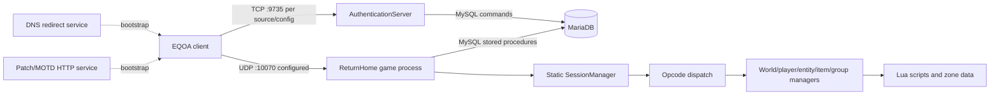

# EQOAGameServer reference survey

## Survey bounds

Surveyed repository: `C:\Users\breen\Projects\EQOAGameServer` at local HEAD `95d0f33` (2026-09-19, “Add deprecation notice to README”). `git status --short` was empty at survey time. The repository was treated as read-only; no reference files were changed. Nighthaven client was not inspected or modified. This is source archaeology, not protocol certification.

Classification: **CONFIRMED** = direct source/config/schema/documentation evidence; **INFERRED** = interpretation; **UNKNOWN** = evidence absent or ambiguous; **OBSOLETE / HISTORICAL** = dated implementation choice, not an inherent protocol requirement.

## Component map

| Path/project | Apparent responsibility and evidence |
|---|---|
| `EQOAGameServer.sln` | Aggregate solution containing ReturnHome, crypto library, auth server |
| `AuthenticationServer/` (`Authserver.csproj`) | TCP account protocol server, account message parsing, account SQL access |
| `EQOACryptoLibrary/` | AES/DES/password hash helpers referenced by auth/game code |
| `ReturnHome/EQOAProto-C-Sharp/` (`ReturnHome.csproj`) | UDP game server executable; startup, world, sessions, packet processing, persistence and gameplay |
| `ReturnHome/EQOAProto-C-Sharp/Server/Network/` | Datagram/segment/message parsing, sessions, ack/retry queues, socket and update channels |
| `Server/Opcodes/` | Opcode IDs, client handlers, server message serializers, chat handlers |
| `Server/Managers/`, `Server/EntityObject/`, `Server/Zone/` | World, player, entity, NPC/actor, combat, item, group, map and event logic |
| `Database/SQL/`, `docker-sql/`, `EQOA_Master.sql` | MySQL/MariaDB query/stored procedure access, schema/bootstrap and seed data |
| `Scripts/` | Lua and JSON event/NPC/quest/item behavior/data loaded as project content; contains copyrighted/game-derived names/content and is not to be copied into Nighthaven |
| root Dockerfiles/compose, `dnsmasq.conf`, `patch/` | Legacy deployment, DNS redirect and static patch/MOTD support |
| `.github/workflows/ci.yml` | Docker container startup workflow; no visible behavioral test assertions |
| `AuthenticationServer/TCPServerTests.sln` | Test solution file exists; survey did not find test source files |

## Runtime architecture

**CONFIRMED startup order:** Game `Main`: read server-list config; initialize optional AES settings in client-auth handler; start a five-second server-list distribution timer; initialize world; initialize UDP socket manager. Auth `Main`: initialize account management; construct and start TCP listener. Compose separately provisions MariaDB, dnsmasq, HTTP patch serving, account and game services.

The diagram records legacy compose/reference topology, not required Nighthaven deployment topology.

**Concurrency:** Auth accepts TCP sockets asynchronously and starts `Task.Run` for each processing loop; tracker is a mutable `List`. Game has async UDP receives via `ReceiveFromAsync`; manager/session/player collections include static mutable state and custom concurrent collections. Game listener invokes packet/session processing after parsing; send queue work and world/event timing are mixed through managers/timers. Exact thread-safety guarantees and global tick behavior are **UNKNOWN**. There is no clear graceful shutdown/cancellation path in inspected listener loops.

**Session lifecycle:** New-instance UDP segment creates a `Session`; endpoint/session identifiers are used for lookup. Reset connection removes from server listing, calls `DropSession(true)`, and removes it from a static session set. Ack paths drive server-list and character-list progress. Session currently contains both persistent-ish player state and connection/session protocol fields. Reconnect restoration semantics are **UNKNOWN**; reference comments discuss saving on disconnect but do not establish retained state after network loss.

**Persistence:** Auth and game access MySQL through SQL helper classes / stored procedures. Character data loads into domain-like objects associated with a session. Reference README claims saving on logoff/disconnect. Source also contains a TODO to save character changes and immediate DB operations. Exact transaction boundaries and durability guarantees require operation-by-operation review.

## Protocol summary

World networking uses UDP and a custom RDP-like framing/reliability layer in `Server/Network`. Account networking uses TCP. See [protocol.md](protocol.md) and [protocol-message-catalog.md](protocol-message-catalog.md) for directly observed IDs and message details. The word “RDP” is a source class name; it does not prove compatibility with a formal RDP specification.

Direct code evidence includes CRC checking, segment header flags, packed lengths, session IDs, message/channel types, arrival/message sequence values, guaranteed ack fields, retransmit queue code, and opcode registry. Parser comments mark several values uncertain. No complete protocol specification or authoritative packet capture was present in the surveyed material.

## Functionality overview

The README calls out world/character selection, character creation/deletion, memory dump, movement, rudimentary player visibility, chat, admin chat, NPC population, and save on disconnect. Opcode registry and domain classes show handlers for many other interactions. This is not equivalent to full feature completeness. See [functional-matrix.md](functional-matrix.md) for per-feature status.

## Principal historical choices

**OBSOLETE / HISTORICAL:** .NET 6 and older pinned package ecosystem; MariaDB 10.2/10.3; Docker based on Ubuntu 20.04; static managers/shared mutable globals; app.config containing endpoint topology; a small UDP receive buffer; external services exposed by one compose file. Their age alone does not make them protocol requirements. Reasons not to inherit include unsupported runtime lifecycle, avoidable coupling, difficult reproducibility/secrets handling, ambiguous ownership, operational exposure, and limited observability/testing.

## Source map for repeatable review

- Startup: `ReturnHome/EQOAProto-C-Sharp/Server/GameServer.cs`, `AuthenticationServer/AuthServer.cs`
- Transport/session: `Server/Network/ServerListener.cs`, `ClientPacket.cs`, `SegmentHeader.cs`, `SegmentBody.cs`, `RdpComm.cs`, `SessionQueues.cs`, `Managers/SessionManager.cs`
- Dispatch/IDs: `Server/Opcodes/Opcodes.cs`, `OpcodeOperations.cs`
- Account: `AuthenticationServer/Server/TCPServer.cs`, `Client.cs`, `Account/ProcessAccount.cs`, `Account/Database/SQLAccount.cs`
- Persistence: `Database/SQL/`, `docker-sql/eqoabase_schema.sql`, `EQOA_Master.sql`
- Deployment: `docker-compose.yml`, Dockerfiles, app.config files, README

